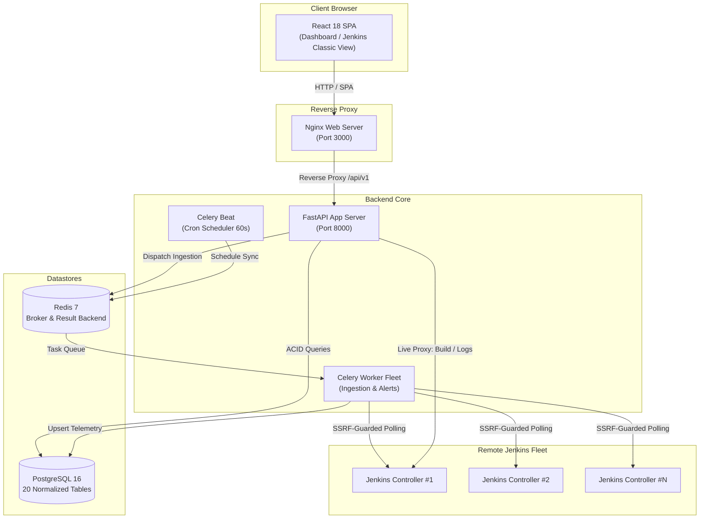

# Jenkins Control Center

[](https://github.com/Gstarksinc/Jenkins-centralized-dashboard-V0.01)
[](https://fastapi.tiangolo.com)
[](https://react.dev)
[](https://www.typescriptlang.org)
[](https://www.postgresql.org)
[](https://redis.io)
[](https://docs.celeryq.dev)
[](https://www.docker.com)

An enterprise-grade, centralized orchestration and observability platform designed to monitor, administer, and trigger builds across multiple independent Jenkins controllers from a single pane of glass.

---

## Table of Contents

- [Key Features](#key-features)
- [Complete Technology Stack](#complete-technology-stack)
- [System Architecture](#system-architecture)
- [Quick Start Deployment](#quick-start-deployment)
- [Default Administrator Credentials](#default-administrator-credentials)
- [UI Pages & Views](#ui-pages--views)
- [REST API Reference](#rest-api-reference)
- [Security Model & SSRF Defense](#security-model--ssrf-defense)
- [Repository Structure](#repository-structure)
- [Automated Testing & Quality Checks](#automated-testing--quality-checks)
- [Troubleshooting & Common Operations](#troubleshooting--common-operations)

---

## Key Features

- **Centralized Multi-Controller Dashboard**: Aggregate telemetry from dozens of distributed Jenkins controllers into a single overview with live status indicators.
- **Classic Jenkins View**: Switch between an enterprise high-level fleet overview and authentic per-controller Jenkins views featuring blue/red/unstable status balls, weather stability icons, build queue widgets, and executor statuses.
- **On-Demand Remote Build Triggering**: Execute builds on any connected controller directly from the dashboard with automated CSRF crumb negotiation and audit logging.
- **Live Console Output Streaming**: Inspect build logs in real time via an embedded dark-themed terminal modal without leaving the interface.
- **Asynchronous Ingestion (Celery + Redis)**: Non-blocking background worker processes query Jenkins REST APIs periodically (every 60s) or on demand.
- **Rule-Based Operational Alerting**: Automated incident tracking for controller timeouts (`CONTROLLER_UNREACHABLE`), agent disconnects (`NODE_OFFLINE`), and queue backlogs (`QUEUE_HIGH`), with operator acknowledge and resolve workflows.
- **Zero Direct-Client Access & SSRF Defense**: All traffic is proxied through the backend with strict loopback, metadata, and private IP blocklists.
- **Write-Only Token Encryption**: Jenkins credentials and API tokens are encrypted at rest using AES-128-CBC + HMAC-SHA256 (Fernet) and never returned in API payloads.
- **Enterprise Authentication & RBAC**: Session-based cookie authentication, Argon2id password hashing, and role-based permissions (`Platform Administrator`, `Developer`, `Auditor`, `Operator`).
- **Internal Domain Support**: Login and user registration support internal enterprise domains (`.local`, `.internal`, `.corp`, etc.).

---

## Complete Technology Stack

### Frontend Application
- **Framework**: [React 18.3](https://react.dev) with [TypeScript 5.6](https://www.typescriptlang.org)
- **Build Tool**: [Vite 5.4](https://vitejs.dev)
- **Styling**: [Tailwind CSS 3.4](https://tailwindcss.com) with `@tailwindcss/forms`
- **Data Fetching & State**: [TanStack Query v5](https://tanstack.com/query) (React Query) with automated cache invalidation and background polling
- **Routing**: [React Router v6](https://reactrouter.com) with protected route session guards
- **Charts & Visualizations**: [Recharts 2.15](https://recharts.org) for 7-day build volume trends
- **Icons**: [Lucide React 0.468](https://lucide.dev)
- **Web Server / Gateway**: [Nginx 1.27 Alpine](https://nginx.org) hosting the static SPA and reverse-proxying `/api/` traffic

### Backend API & Services
- **Runtime**: [Python 3.12](https://www.python.org)
- **Framework**: [FastAPI 0.115](https://fastapi.tiangolo.com)
- **ASGI Server**: [Uvicorn 0.34](https://www.uvicorn.org) bound to `0.0.0.0:8000`
- **Data Validation & Serialization**: [Pydantic v2.10](https://docs.pydantic.dev)
- **ORM**: [SQLAlchemy 2.0](https://www.sqlalchemy.org) with connection pooling (`pool_size=10`, `max_overflow=20`)
- **Database Driver**: [Psycopg 3.2](https://www.psycopg.org) (native C-extension binary)
- **Database Migrations**: [Alembic 1.14](https://alembic.sqlalchemy.org)
- **HTTP Client**: [HTTPX 0.28](https://www.python-httpx.org) (async non-blocking requests)
- **Cryptography & Security**:
  - `argon2-cffi` for memory-hard Argon2id password hashing
  - `cryptography` (Fernet authenticated encryption) for Jenkins API tokens
  - Custom multi-layer SSRF Guard (`app.core.ssrf_guard`)

### Asynchronous Processing & Cache
- **Distributed Task Queue**: [Celery 5.4](https://docs.celeryq.dev) (4 concurrent worker processes)
- **Periodic Scheduler**: **Celery Beat 5.4** (dispatches multi-controller sync every 60 seconds)
- **Message Broker & Cache**: [Redis 7.4 Alpine](https://redis.io) (DB 0 for broker, DB 1 for task results)

### Database Layer
- **Relational Store**: [PostgreSQL 16 Alpine](https://www.postgresql.org) with 20 normalized tables and UUID primary keys

### Containerization & Deployment
- **Docker Compose**: Multi-container orchestration (6 isolated services with health checks and volume persistence)

---

## System Architecture



> **For detailed architecture, data models, and security workflows, see [docs/ARCHITECTURE.md](docs/ARCHITECTURE.md).**

---

## Quick Start Deployment

### Prerequisites
- Docker Engine 24.0+ and Docker Compose v2.0+
- Git

### Deploying with Docker Compose

1. **Clone the repository**:
   ```bash
   git clone https://github.com/Gstarksinc/Jenkins-centralized-dashboard-V0.01.git
   cd Jenkins-centralized-dashboard-V0.01
   ```

2. **Configure environment settings (optional)**:
   ```bash
   cp .env.example .env
   ```

3. **Start all services**:
   ```bash
   docker compose up -d --build
   ```

4. **Verify running containers**:
   ```bash
   docker compose ps
   ```
   You should see 6 healthy containers running:
   - `jcc-frontend` (Port `0.0.0.0:3000:80`)
   - `jcc-backend` (Port `0.0.0.0:8000:8000`)
   - `jcc-postgres` (Port `0.0.0.0:5432:5432`)
   - `jcc-redis` (Port `0.0.0.0:6379:6379`)
   - `jcc-worker` (Celery background worker)
   - `jcc-beat` (Celery beat periodic scheduler)

5. **Open the web dashboard**:
   - Access the platform at: **`http://<SERVER_PUBLIC_IP>:3000`** (or `http://localhost:3000`)
   - Interactive Swagger API Documentation: **`http://<SERVER_PUBLIC_IP>:8000/docs`**

---

## Default Administrator Credentials

On initial startup, the backend automatically bootstraps the platform administrator account:

| Field | Value |
| :--- | :--- |
| **Email** | `admin@company.local` |
| **Password** | `Admin12345!` |
| **Role** | `Platform Administrator` |

> **Password Reset Command**:
> If you ever need to reset the admin password directly on the server:
> ```bash
> docker compose exec backend python -m app.core.bootstrap_admin --email "admin@company.local" --password "YourNewPassword123!" --reset-password
> ```

---

## UI Pages & Views

| Page | Route | Description |
| :--- | :--- | :--- |
| **Login** | `/login` | Secure session login page with support for enterprise internal domain emails. |
| **Overview** | `/` | Dual-mode dashboard: interactive controller switcher, authentic Jenkins view, and toggleable fleet analytics. |
| **Jenkins Servers**| `/servers` | Register, edit, and test controllers with real-time feedback, encryption, and on-demand sync. |
| **Jobs & Pipelines**| `/jobs` | Search, filter by controller, view health scores, trigger immediate builds, and sync jobs. |
| **Build History** | `/builds` | Execution runs across controllers, status badges, durations, and live console output modal. |
| **Nodes & Agents** | `/nodes` | Agent capacity monitoring, executor utilization (busy vs. idle), labels, and offline reasons. |
| **Alerts & Incidents**| `/alerts` | Operational alerts (`CONTROLLER_UNREACHABLE`, `NODE_OFFLINE`, `QUEUE_HIGH`) with acknowledge and resolve actions. |
| **Users & RBAC** | `/users` | Platform user creation, status management, and role assignments. |
| **Audit Trail** | `/audit` | Tamper-evident, append-only security audit log recording logins, server changes, and build triggers. |
| **Analytics** | `/analytics` | High-level performance trends and throughput charts. |
| **Settings** | `/settings` | System-wide configuration toggles. |

---

## REST API Reference

All backend API endpoints are versioned under `/api/v1`.

| Router | Method | Path | Summary |
| :--- | :--- | :--- | :--- |
| **Auth** | `POST` | `/api/v1/auth/login` | Authenticate user credentials and create session |
| | `POST` | `/api/v1/auth/logout` | Revoke session and clear cookies |
| | `GET` | `/api/v1/auth/me` | Fetch active user profile and roles |
| | `POST` | `/api/v1/auth/change-password` | Update account password |
| **Health** | `GET` | `/api/v1/health/live` | Liveness health probe |
| | `GET` | `/api/v1/health/ready` | Readiness probe (checks DB & Redis) |
| **Servers** | `GET` | `/api/v1/servers` | List all registered Jenkins controllers |
| | `POST` | `/api/v1/servers` | Register a new Jenkins controller |
| | `POST` | `/api/v1/servers/test-connection` | SSRF-guarded connectivity & auth check |
| | `POST` | `/api/v1/servers/{id}/sync` | Trigger immediate background data ingestion |
| | `DELETE` | `/api/v1/servers/{id}` | Remove controller registration and credentials |
| **Dashboard**| `GET` | `/api/v1/dashboard/summary` | Multi-controller fleet metrics snapshot |
| | `GET` | `/api/v1/dashboard/build-trends` | 7-day build volume breakdown by outcome |
| **Jobs** | `GET` | `/api/v1/jobs` | List CI/CD jobs across controllers |
| | `GET` | `/api/v1/jobs/{id}/builds` | Retrieve build execution history for a job |
| | `POST` | `/api/v1/jobs/{id}/build` | Trigger a build execution upstream |
| **Builds** | `GET` | `/api/v1/builds` | List historical builds with status filtering |
| | `GET` | `/api/v1/builds/{id}/console` | Proxy raw console log from Jenkins |
| **Nodes** | `GET` | `/api/v1/nodes` | List agent nodes, executors, and labels |
| **Alerts** | `GET` | `/api/v1/alerts` | List operational health alerts |
| | `PATCH` | `/api/v1/alerts/{id}/acknowledge` | Acknowledge active alert |
| | `PATCH` | `/api/v1/alerts/{id}/resolve` | Mark alert as resolved |
| **Users** | `GET` | `/api/v1/users` | List platform users |
| | `POST` | `/api/v1/users` | Create user with Argon2id password hash |
| | `GET` | `/api/v1/roles` | List available RBAC roles |

> **For complete request/response schemas, see [docs/API_REFERENCE.md](docs/API_REFERENCE.md).**

---

## Security Model & SSRF Defense

1. **Write-Only Credential Storage**: Jenkins API tokens are encrypted in the database using Fernet (`AES-128-CBC` + `HMAC-SHA256`) and are never returned over the network.
2. **SSRF Guard**: Destination URLs are validated before outbound dispatch. Outbound connections to `127.0.0.0/8`, `169.254.169.254`, and cloud metadata endpoints are strictly blocked.
3. **Private Subnets Toggle**: For internal Jenkins setups, `ALLOW_PRIVATE_IPS_FOR_JENKINS=true` can be set in `.env` to permit private subnets (`10.0.0.0/8`, `192.168.0.0/16`) while maintaining metadata and loopback blocking.
4. **Append-Only Audit Trail**: Every sensitive operation (login, server creation, password change, build trigger) is committed to an immutable `audit_events` log table.

---

## Repository Structure

```text
jenkins-control-center/
├── compose.yaml                # Multi-service Docker Compose deployment
├── .env.example                # Sample environment configuration
├── README.md                   # Primary system documentation
├── docs/
│   ├── ARCHITECTURE.md         # Detailed architectural design & workflows
│   └── API_REFERENCE.md        # Complete REST API specification
├── frontend/
│   ├── src/
│   │   ├── api/                # HTTP client with session token handling
│   │   ├── components/         # JenkinsDashboardView, JenkinsStatusBall, WeatherIcon
│   │   ├── context/            # AuthContext (session state & login/logout)
│   │   ├── layouts/            # ApplicationLayout, Sidebar, Topbar
│   │   ├── pages/              # 12 application pages (Overview, Servers, Jobs, etc.)
│   │   ├── types/              # TypeScript interfaces for API models
│   │   └── App.tsx             # Route definitions with ProtectedRoute guards
│   ├── package.json            # Node.js dependencies
│   ├── Dockerfile              # Multi-stage Vite build & Nginx runtime
│   └── nginx.conf              # SPA routing & API reverse proxy configuration
└── backend/
    ├── app/
    │   ├── api/v1/             # Modular REST routers (auth, servers, jobs, etc.)
    │   ├── core/               # Security, bootstrap_admin, SSRF guard, logging
    │   ├── db/                 # SQLAlchemy engine, session maker, declarative base
    │   ├── integrations/       # Asynchronous Jenkins HTTP client with CSRF support
    │   ├── models/             # 20 normalized SQLAlchemy ORM models
    │   ├── schemas/            # Pydantic v2 validation models
    │   ├── services/           # Audit logging service
    │   ├── workers/            # Celery app, tasks_sync, and beat schedule
    │   ├── config.py           # Pydantic BaseSettings application config
    │   └── main.py             # FastAPI entry point & CORS configuration
    ├── migrations/             # Alembic database schema migrations
    ├── tests/                  # Pytest automated test suite (18 tests)
    ├── entrypoint.sh           # Container entry point (DB wait, migrations, bootstrap)
    ├── requirements.txt        # Python package dependencies
    └── Dockerfile              # Production Python 3.12 container definition
```

---

## Automated Testing & Quality Checks

### Running Backend Tests
The repository includes an automated pytest suite covering configuration, models, SSRF defenses, authentication, server registration, and Phase B/D features:

```bash
cd backend
python -m pytest tests -v
```

### Running Frontend Type Checks & Build
```bash
cd frontend
npm run build
```

---

## Troubleshooting & Common Operations

### Checking Service Logs
To view logs for any individual container:
```bash
# Backend API logs
docker compose logs -f backend

# Celery Ingestion Worker logs
docker compose logs -f celery_worker

# Celery Beat Scheduler logs
docker compose logs -f celery_beat

# Frontend / Nginx logs
docker compose logs -f frontend
```

### Stopping the Services
```bash
# Stop and remove containers
docker compose down

# Stop and remove containers AND database volumes
docker compose down -v
```

### Restarting Services After Updates
```bash
git pull origin main
docker compose up -d --build
```
