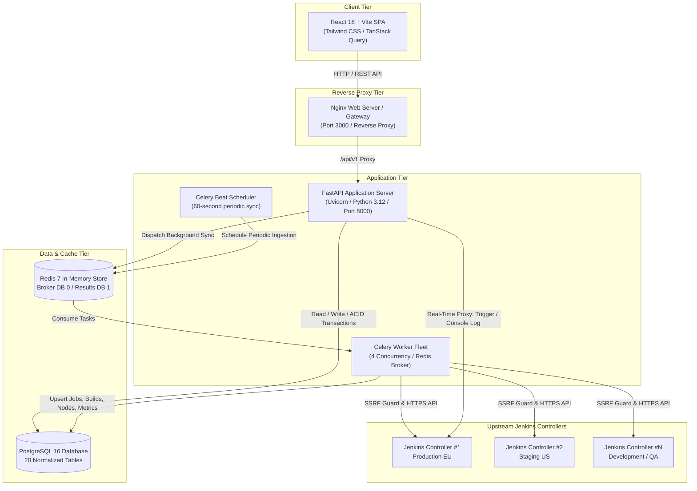
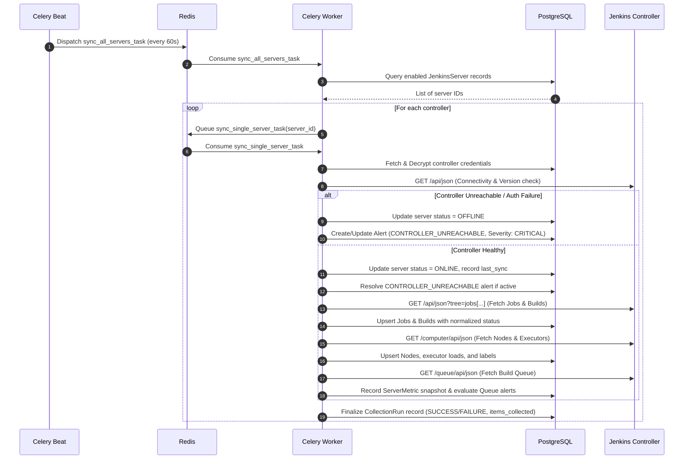

# Jenkins Control Center — System Architecture & Design

## 1. Executive Summary

**Jenkins Control Center** is an enterprise-grade multi-controller management platform designed to monitor, administer, and orchestrate multiple independent Jenkins instances from a single, unified interface.

The system enforces a **strict security perimeter**: browser clients never communicate directly with upstream Jenkins controllers. All API queries, credential handshakes, build triggers, and log streaming are brokered through an asynchronous, SSRF-defended FastAPI backend service.

---

## 2. High-Level Architecture Diagram

---

## 3. Technology Stack Breakdown

| Layer | Component | Version | Purpose & Description |
| :--- | :--- | :--- | :--- |
| **Frontend UI** | **React** | `18.3.1` | Component-based interactive UI library |
| | **TypeScript** | `5.6.2` | Compile-time static type safety and contract verification |
| | **Vite** | `5.4.21` | Modern frontend bundler and development server |
| | **Tailwind CSS** | `3.4.17` | Utility-first responsive design and styling system |
| | **TanStack Query** | `5.67.2` | Server-state caching, automatic refetching, and query invalidation |
| | **Recharts** | `2.15.1` | Declarative SVG charting for build volume and health trends |
| | **Lucide Icons** | `0.468.0` | Clean, modern iconography across all navigation and action controls |
| **Reverse Proxy**| **Nginx** | `1.27-alpine` | High-performance static SPA host and reverse proxy for backend APIs |
| **Backend API** | **Python** | `3.12` | Core backend runtime environment |
| | **FastAPI** | `0.115.x` | High-performance asynchronous REST API framework |
| | **Uvicorn** | `0.34.x` | Production ASGI web server running on `0.0.0.0:8000` |
| | **Pydantic** | `v2.10.x` | Strict request/response data validation and serialization |
| | **SQLAlchemy** | `2.0.x` | Next-generation Python ORM with connection pooling (`pool_size=10`) |
| | **Psycopg 3** | `3.2.x` | Native, fast PostgreSQL client driver for Python |
| | **Alembic** | `1.14.x` | Schema migrations with automated revision tracking |
| | **HTTPX** | `0.28.x` | Fully asynchronous HTTP client for upstream Jenkins API integration |
| **Background** | **Celery** | `5.4.x` | Distributed asynchronous task queue for data ingestion and alerting |
| | **Celery Beat** | `5.4.x` | Cron scheduler executing periodic multi-controller polling |
| | **Redis** | `7.4-alpine` | High-speed in-memory message broker and caching layer |
| **Relational DB**| **PostgreSQL** | `16-alpine` | Primary ACID relational database with 20 normalized tables |
| **Security** | **Argon2id** | `argon2-cffi` | Memory-hard cryptographic password hashing |
| | **Fernet** | `cryptography` | Authenticated symmetric encryption (AES-128-CBC + HMAC-SHA256) |
| | **SSRF Guard** | Custom | Multi-layer IP/DNS destination validation preventing network pivot |
| **Container** | **Docker** | `Compose v2` | Multi-container orchestration, volume management, and health checks |

---

## 4. Security Architecture

### 4.1 Zero Direct-Client Communication
Client browsers never make direct network requests to any upstream Jenkins controller. This architecture eliminates:
- CORS configuration issues on upstream Jenkins controllers.
- Leakage of Jenkins API tokens or admin credentials to end-user browsers.
- Direct network route exposure between client workstations and Jenkins private clusters.

### 4.2 Write-Only Secret Encryption (Fernet)
When a user registers or updates a Jenkins controller, the secret API token or password is encrypted using authenticated symmetric encryption (**AES-128-CBC with HMAC-SHA256 authentication** via Fernet) before persistence into `credential_references.encrypted_secret`:
- Secret tokens are **never returned** in any API response or UI view.
- Only background workers and authorized proxy endpoints decrypt the token in-memory using `SECRET_KEY_ENCRYPTION`.

### 4.3 SSRF (Server-Side Request Forgery) Defense
The custom SSRF protection module (`app.core.ssrf_guard`) enforces:
1. **Scheme Validation**: Strictly restricts URLs to `http://` and `https://`.
2. **DNS Resolution Verification**: Resolves domain names before dispatching requests.
3. **Private IP Range Blocking**: Rejects loopback (`127.0.0.0/8`), RFC 1918 private subnets (`10.0.0.0/8`, `172.16.0.0/12`, `192.168.0.0/16`), link-local addresses (`169.254.0.0/16`), and AWS/GCP/Azure instance metadata endpoints.
4. **Internal Test Environment Toggle**: For on-premise or test environments where Jenkins runs inside private networks, the `ALLOW_PRIVATE_IPS_FOR_JENKINS=true` flag safely relaxes private subnet blocking while maintaining metadata and loopback protections.

### 4.4 Enterprise Domain Support
Authentication schemas validate email addresses without strict public top-level domain restrictions, allowing enterprise internal domains such as `admin@company.local`, `dev@corp.internal`, or custom `.lan` domains.

---

## 5. Background Ingestion & Alerting Workflow

---

## 6. Database Schema Summary

The database uses **20 normalized tables** configured with UUID primary keys and foreign key constraints:

1. `users`: Identity records with Argon2id password hashes, account status, and bootstrap admin flags.
2. `roles`: Default system roles (`Platform Administrator`, `Developer`, `Auditor`, `Operator`).
3. `permissions`: Granular capability flags.
4. `user_roles`: Many-to-many junction between users and roles.
5. `role_permissions`: Many-to-many junction between roles and permissions.
6. `teams`: Team organizational units.
7. `team_members`: Membership associations with roles within teams.
8. `jenkins_servers`: Registered Jenkins controllers with health states and configuration.
9. `jenkins_server_access`: Per-user/team access levels (`READ`, `OPERATE`, `ADMINISTER`) on controllers.
10. `credential_references`: Write-only Fernet encrypted tokens and authentication types.
11. `jobs`: Normalized CI/CD jobs, folder paths, types, health scores, and last build metadata.
12. `jenkins_job_access`: Granular trigger and view permissions per job.
13. `builds`: Historical build executions with normalized outcomes (`SUCCESS`, `FAILURE`, `RUNNING`, etc.).
14. `nodes`: Build agent inventory, online/offline causes, executor capacities, and assigned labels.
15. `server_metrics`: Time-series performance telemetry snapshots (queue length, busy executors).
16. `collection_runs`: Auditable ingestion records documenting collection duration and item counts.
17. `alert_rules`: User-configurable alerting policies and thresholds.
18. `alerts`: Active, acknowledged, and resolved incident records.
19. `audit_events`: Tamper-evident append-only compliance logs for security actions.
20. `sessions`: Server-side authenticated user session records with expiration tracking.
